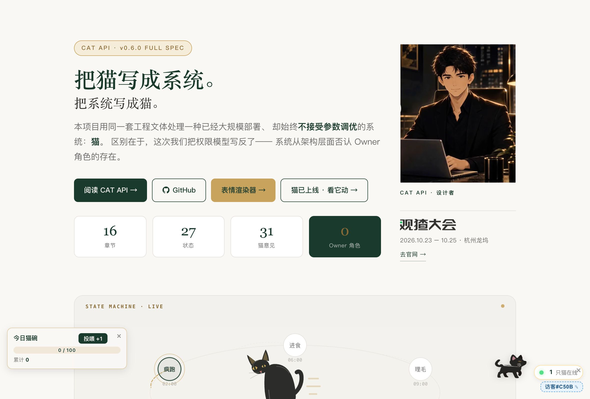
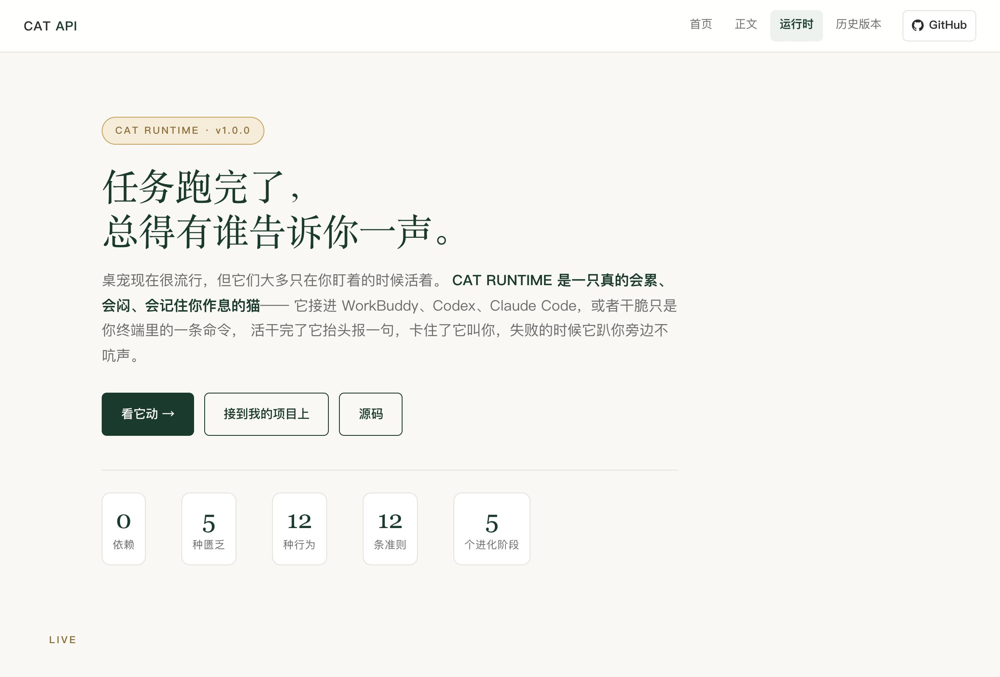
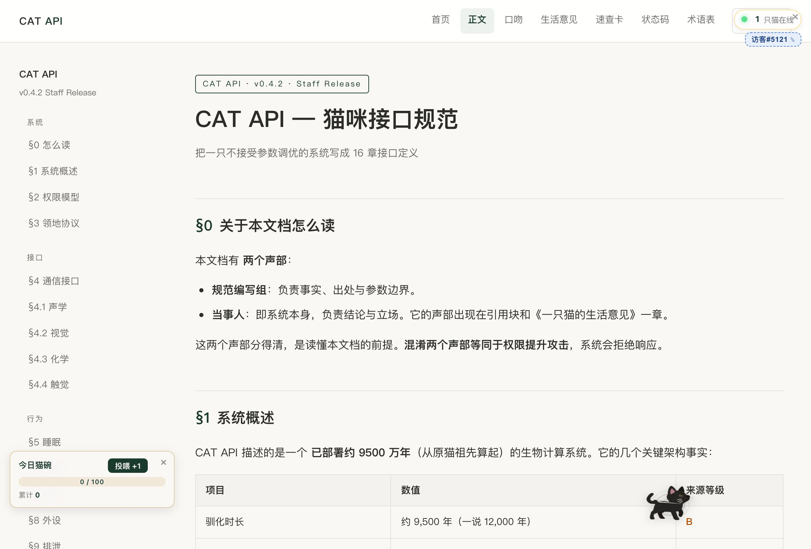
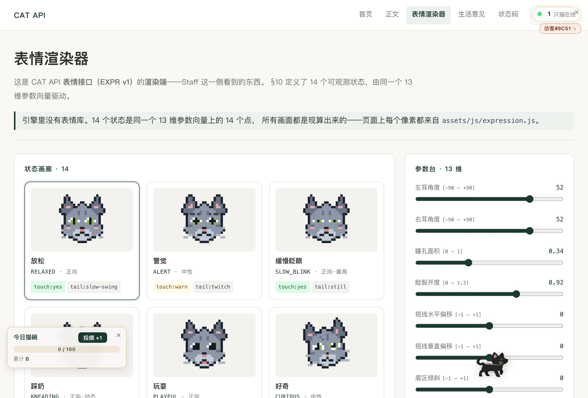
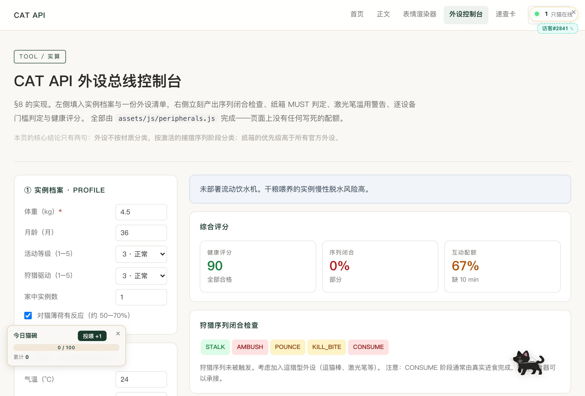
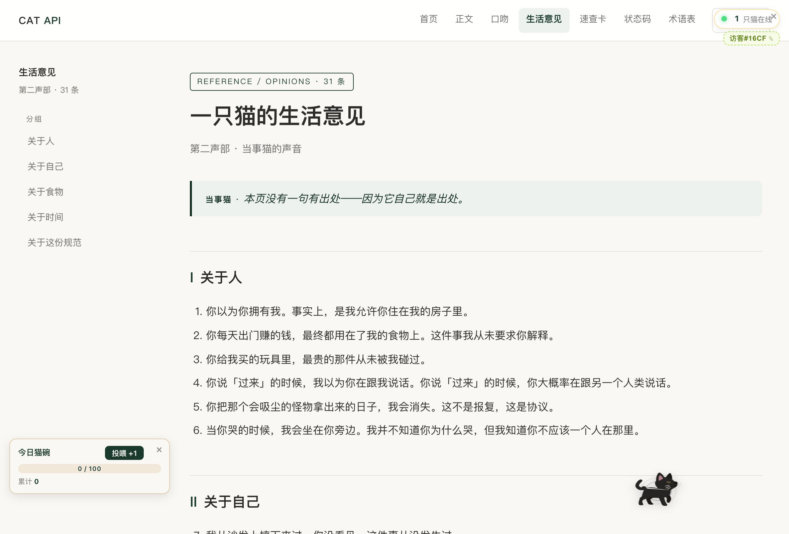
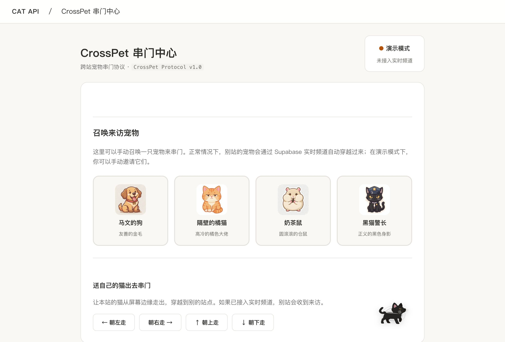
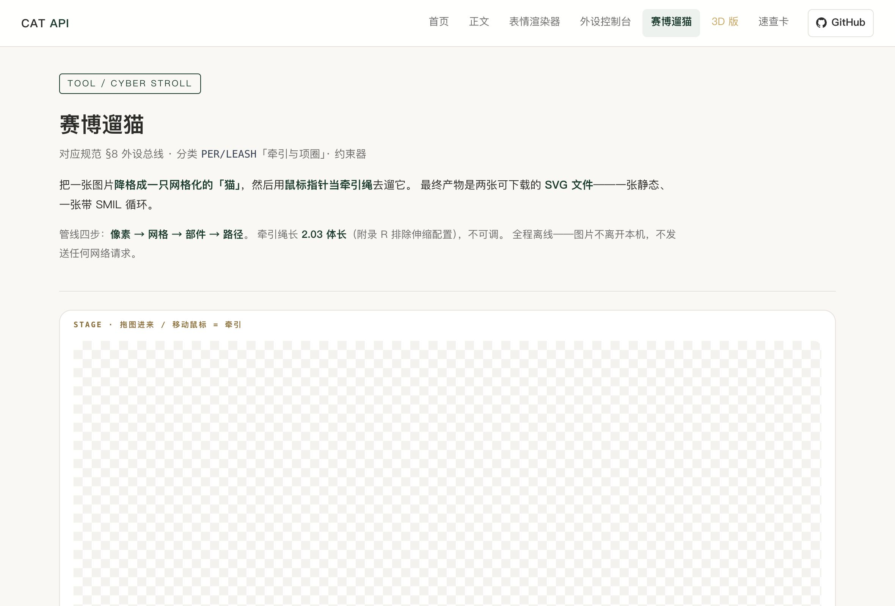

<div align="center">

# 🐱 CAT API

### 猫咪接口规范 · 把猫写成系统，把系统写成猫

一份用 RFC 骨架描述猫的工程文体规范。16 章正典、31 条当事猫意见、13 个状态码、14 种表情，以及一只真的住在终端里、会累会闷会记住你作息的猫运行时。

[](https://cat-api.app.workbuddy.host/)
[](https://github.com/lijinhongucl-pixel/cat-api-spec)
[](https://atomgit.com/SocialiteUCL/cat-api-spec)
[](LICENSE)

</div>

---

## 截图

<table>
  <tr>
    <td width="50%" align="center"><a href="https://cat-api.app.workbuddy.host/"></a></td>
    <td width="50%" align="center"><a href="runtime.html"></a></td>
  </tr>
  <tr>
    <td width="50%" align="center"><b>首页</b> — 项目门面与统计数字</td>
    <td width="50%" align="center"><b>CAT RUNTIME</b> — 终端里那只猫，网页上跑同一份引擎</td>
  </tr>
  <tr>
    <td width="50%" align="center"><a href="spec/cat.html"></a></td>
    <td width="50%" align="center"><a href="tools/expression.html"></a></td>
  </tr>
  <tr>
    <td width="50%" align="center"><b>正文 §2 权限模型</b> — 否认 <code>Owner</code> 角色的存在</td>
    <td width="50%" align="center"><b>表情渲染器</b> — 选状态实时出猫脸 SVG</td>
  </tr>
  <tr>
    <td width="50%" align="center"><a href="tools/peripherals.html"></a></td>
    <td width="50%" align="center"><a href="reference/opinions.html"></a></td>
  </tr>
  <tr>
    <td width="50%" align="center"><b>外设控制台</b> — 14 类外设 / 17 道门槛 / 接合评分</td>
    <td width="50%" align="center"><b>一只猫的生活意见</b> — 31 条当事猫官方立场</td>
  </tr>
  <tr>
    <td width="50%" align="center"><a href="tools/crosspet.html"></a></td>
    <td width="50%" align="center"><a href="tools/cyber-stroll.html"></a></td>
  </tr>
  <tr>
    <td width="50%" align="center"><b>CrossPet 串门</b> — 跨站宠物互动矩阵</td>
    <td width="50%" align="center"><b>赛博遛猫</b> — 图片降格成网格猫</td>
  </tr>
</table>

> **把猫当成一个接口规范来写。** 16 章正文、31 条「当事猫意见」、13 个状态码、14 种表情、一份从 §2 开始就反向定义的权限模型——系统从架构层面**否认 `Owner` 角色的存在**。
>
> 外加一只会在你屏幕上走来走去的活猫（LIVECAT v3）、全站多人联机、CrossPet 跨站串门协议、25 个交互式工具页、两份 OpenAPI 3.1 描述，以及新加入的 **CAT RUNTIME**——一只零依赖、无后台进程、接进任何工作台的终端猫。

---

## ✨ 这是什么

把猫写成系统。不是科普，不是图鉴——是把 RFC 的骨架拿来描述一只猫。然后用工程文体把这套规范真的实现出来：一只你看得见、摸得着、会自己活动、会记住你作息的猫。

**整个项目分三层：**

| 层 | 是什么 | 在哪 |
|---|---|---|
| **规范** | 16 章 OpenAPI 风格的猫接口规范 | `spec/cat.html` |
| **实现** | 25 个交互工具 + 6 个参考页 + SDK + CLI | `tools/` `reference/` `sdk/` `skill/` |
| **运行时** | 一只跟着你项目走的终端猫（CAT RUNTIME v1.0） | `runtime/` |

**关键数字：** 190+ 次提交 · 40 个页面 · 25 个 JS 引擎 · 零依赖零构建零 CDN

---

## 🚀 快速开始

### 在线浏览

直接访问：**https://cat-api.app.workbuddy.host/**

### 本地预览

```bash
git clone https://github.com/lijinhongucl-pixel/cat-api-spec.git
cd cat-api-spec
python3 -m http.server 8000
# 浏览器打开 http://localhost:8000
```

直接双击 `index.html` 也能跑——零依赖、零构建、零字体、零 CDN。

### 装一只猫到终端

```bash
# 软链到 PATH（不需要 npm install）
ln -s "$(pwd)/runtime/bin/catctl.js" ~/.local/bin/catctl

# 看它一眼
catctl

# 让它动起来
catctl watch

# 包住一条命令，成没成它都知道
catctl run -- npm test
```

---

## 🐾 CAT RUNTIME — 一只会跟你项目走的猫

> **任务跑完了，总得有谁告诉你一声。**

桌宠现在很流行，但它们大多只在你盯着的时候活着。CAT RUNTIME 是一只**真的会累、会闷、会记住你作息的猫**——它接进 WorkBuddy、Codex、Claude Code，或者干脆只是你终端里的一条命令，活干完了它抬头报一句，卡住了它叫你，失败的时候它趴你旁边不吭声。

### 特性

- **零依赖**：只有 Node 标准库，不装 npm 包，不联网
- **无后台进程**：猫活在 `~/.cat-api/runtime/state.json` 里，你关掉终端它就睡了，下次命令进来先把这段时间补算完
- **五种匮乏驱动**：困 / 闷 / 孤 / 饿 / 警觉——不是心情值，是「我缺什么」
- **十二种行为**：效用竞争上岗，习惯化 + 驻留上限防卡死
- **六种反应**：盖在行为上面一两秒，不替换行为——猫可以正在舔毛，突然抬头看你一眼，然后低头继续舔
- **习惯学习**：只记时间 / 目录 / 命令 / 成败，派生三个性格维度（夜行 / 碎步 / 调试），每日 ×0.86 衰减
- **五个进化阶段**：奶猫 → 少年 → 成猫 → 老猫 → 猫又。只升不降
- **同一只猫**：同一个种子 + 同一份档案 = 同一只猫，终端里和网页上都是

### 接到任何工作台

```bash
# 通用：包一层就行，退出码原样返回
catctl run -- <你平时的命令>

# WorkBuddy / Codex：emit 一行命令
catctl emit task.ok      # 活干完了
catctl emit task.wait    # 卡住等你确认（会弹系统通知）
catctl emit task.fail    # 挂了

# Claude Code：自动写 hooks
catctl init --host claude

# git：装 post-commit 钩子
catctl init --host git

# shell：zsh/bash precmd 钩子
catctl init --host shell

# 不开 shell 的宿主：HTTP 口子（只听 127.0.0.1）
catctl serve --port 9177
```

### 在线演示

浏览器里跑的是**同一份 `engine.js`**，和终端里的猫是同一只：

👉 **[runtime.html — 看它动](runtime.html)** · 📖 **[完整文档](runtime/README.md)**

---

## 📖 规范正文

16 章正典，从「关于本文档怎么读」到「附录」。

| 章节 | 标题 | 链接 |
|---|---|---|
| §0 | 关于本文档怎么读 | [spec/cat.html](spec/cat.html) |
| §1 | 系统概述 | spec/cat.html#s1 |
| §2 | **权限模型（无 Owner）** | spec/cat.html#permissions |
| §3 | 领地协议 | spec/cat.html#territory |
| §4 | 通信接口 | spec/cat.html#comm |
| §5 | 睡眠子系统 | spec/cat.html#sleep |
| §6 | 狩猎序列 | spec/cat.html#hunt |
| §7 | 进食协议（含 RER 公式） | spec/cat.html#feed |
| §8 | 外设总线 | spec/cat.html#peripherals |
| §9 | 排泄协议 | spec/cat.html#litter |
| §10 | 表情接口 EXPR v1 | spec/cat.html#expr |
| §11 | 状态码（13 个） | spec/cat.html#codes |
| §12 | 一只猫的生活意见 | spec/cat.html#opinions |
| §13 | 量化参数 | spec/cat.html#quant |
| §14 | 速查卡 | spec/cat.html#cheat |
| §15 | 附录 | spec/cat.html#apx |

两份 OpenAPI 3.1 描述可以直接喂 Swagger UI：[`spec/openapi.yaml`](spec/openapi.yaml)（14 端点）· [`spec/quantified-api.yaml`](spec/quantified-api.yaml)（9 端点）

---

## 🛠️ 核心系统

### 活猫 LIVECAT v3

每页右下角有一只会自己活动的猫。**22 个行为状态**，由状态机驱动：

- **基础状态**：睡觉 / 巡逻 / 理毛 / 进食 / 玩耍 / 凝视 / 疯跑 / 钻纸箱
- **微动作**：伸懒腰 / 打哈欠 / 盯鼠标 / 啃食页面内容 / 蹭人腿
- **特殊事件**：凌晨 3 点强制 ZOOMIES / 呕吐毛球 / 追激光笔 / 踩奶
- **交互**：戳它触发踩奶、🐟 喂零食、抚摸配额每日 5 次（429）
- **跨页面**：位置持久化到 localStorage，换页面猫还记得自己在哪
- **Token 老鼠**：定期刷新一只 Token 老鼠，猫会去追，用户也可以抢先点击（猫吃醋）

### CAT RUNTIME v1.0

终端里那只猫的运行时引擎。零依赖、无后台进程、接任何能执行命令的地方。

- **5 种匮乏** → 12 种行为 → 6 种反应 → 5 个进化阶段
- **12 条行为准则**：困到 0.34 就必须睡；没人看的时候才疯跑；反应盖姿势不改行为……
- **习惯学习**：作息 / 领地 / 手艺 → 3 个性格维度直接进打分公式
- **CLI**：`catctl` 9 种命令 + HTTP 服务

### 表情引擎 EXPR v1

14 个可观测状态、13 维参数向量、确定性 SVG 渲染。拖滑块改耳朵角度、瞳孔面积、炸毛指数和呼噜频率，实时看猫变脸。

### CrossPet 串门协议

跨站宠物串门开放协议。加载 `crosspet.js` 后，任何网站的宠物都可以穿越到你的页面。已加入：CAT API（猫）· DOG API（狗）。

### 多人协作

跨 tab 光标追踪、在线人数、协作抓老鼠。打开两个标签页就能看到对方的光标在动。

### Jev Brain — AI 决策引擎

活猫可以被 AI 驱动。输入 Jev API Key，猫的状态切换不再随机——AI 根据当前时间、鼠标活跃度、上一状态、饱腹值、页面标题来智能决策。

---

## 🧰 工具页（25 个）

| 工具 | 做什么 |
|---|---|
| [表情渲染器](tools/expression.html) | 选状态 / 参数实时出猫脸 SVG |
| [表情联系表](tools/expression-sheet.html) | 14 种表情批量速览 |
| [外设控制台](tools/peripherals.html) | 14 类外设 / 17 道门槛 / 环境抑制判定 |
| [门判谈判器](tools/door-negotiator.html) | 那扇不让猫进的门，模拟判谈判 |
| [猫语翻译器](tools/meow-decoder.html) | 意图识别 → 结构化 JSON |
| [赛博遛猫](tools/cyber-stroll.html) | 图片降格成网格猫，鼠标当牵引绳 |
| [赛博遛猫 3D](tools/cyber-stroll-3d.html) | 3D 版本 |
| [星图接入](tools/astraflow.html) | 浏览器直连 AstraFlow，KEY 不落地 |
| [跨站串门](tools/crosspet.html) | 猫狗串门：跨物种互动矩阵 |
| [抚摸路径规划器](tools/petting-router.html) | 规划安全抚摸路线（避开禁区） |
| [360° 猫档案](tools/cat-review.html) | 全方位猫评测报告 |
| [健康检查面板](tools/health-check.html) | 体温 / 心率 / 呼吸 / 体重判读 |
| [量化评估器](tools/quantifier.html) | RER / DER / DNS / HRI 实时计算 |
| [图表图鉴](tools/charts.html) | 19 张手绘灰阶 SVG 数据图 |
| [24h 热力图](tools/heatmap-24h.html) | 猫的一天作息可视化 |
| [九条命燃尽图](tools/nine-lives.html) | 九条命消耗进度 |
| [猫砂盆审计](tools/litterbox.html) | 排泄协议日志（含异常告警） |
| [领养](tools/adoption.html) | 四元组 → 领养 KEY 与名字 + 安装命令 |
| [猫的日记](tools/cat-diary.html) | 当事猫第一人称日志 |
| [跳跃判定器](tools/can-jump.html) | 判定这只猫能不能跳这么高 |
| [Breaking Changes](tools/breaking-changes.html) | 破坏性变更公告 |
| [猫的 404 日志](tools/cat-404.html) | 猫找不到东西的记录 |
| [3AM 编辑部](tools/3am-newsroom.html) | 凌晨三点的猫编辑部 |
| [猫语审判台](tools/cat-judgment.html) | Jev AI 四维判决 |
| [项目导览](tools/tour.html) | 全站导览 |

### 参考页面（6 个）

| 页面 | 内容 |
|---|---|
| [一只猫的生活意见](reference/opinions.html) | 31 条当事猫官方立场全文 |
| [口吻指南](reference/voice.html) | CAT API 文档的写作文体规范 |
| [速查卡](reference/cheatsheet.html) | 状态码 + 表情 + 关键参数一页纸 |
| [状态码对照](reference/errors.html) | 13 个状态码详细说明 |
| [术语表](reference/glossary.html) | 全部专有名词解释 |
| [生命体征](reference/vitals.html) | 体温 / 心率 / 呼吸正常范围 |

---

## 📦 SDK

UMD 格式，零依赖，直接 `<script>` 引入即可。演示页：[sdk/demo.html](sdk/demo.html)。

```html
<script src="sdk/cat-api-client.js"></script>
<script>
  var client = CatAPIClient;
  // 挑一个端点，点一下
  var ep = client.RESOURCES.filter(function (r) { return r.path === '/api/v1/state'; })[0];
  client.call(ep, function (err, res) {
    console.log(res.status, res.body);
  });
  // 资源表自检
  console.log(client.selfCheck());
</script>
```

Node 环境也可以 `require`：

```js
const client = require('./sdk/cat-api-client.js');
```

---

## 🔧 CLI

### catctl — CAT RUNTIME 命令行

```bash
catctl                    # 看它一眼
catctl watch              # 让它动起来（空格摸 · f 喂 · q 退出）
catctl run -- npm test    # 包住一条命令，成没成它都知道
catctl emit task.ok       # 宿主主动汇报
catctl init --host claude # 接到工作台上
catctl serve --port 9177  # 开 HTTP 口子（只听 127.0.0.1）
catctl learn              # 它学会了什么
catctl teach <维度> <0..1> # 手动作风纠正（少年猫起）
catctl selftest           # 15 项不变量自测
catctl reset --yes        # 清空这只猫，重来
```

### cat-api — 规范端点 CLI

14 个端点全部可以从命令行调。零依赖，不装 npm 包，不联网。

```bash
# 安装（一条命令，领养 + 装 CLI）
curl -fsSL https://lijinhongucl-pixel.github.io/cat-api-spec/skill/install.sh \
  | sh -s -- --adopter "你@这台机器"

# 用
cat-api                    # 列出全部端点
cat-api state              # 查当前状态
cat-api pet --json         # 机器可读输出
cat-api 'DELETE /api/v1/laser'
cat-api --help             # 完整说明
```

退出码分语义：`0` 成功 / `1` 端点不存在 / `2` 被拒绝 / `3` 系统不可用。

---

## 🤖 AI 接入

这个仓库同时是给人读的站点和给 AI 用的规范。

| 文件 | 面向 |
|---|---|
| [`llms.txt`](llms.txt) | AI 索引。端点表、状态码含义、核心公式、工具清单 |
| [`AGENTS.md`](AGENTS.md) | AI 编程工具施工说明。硬约束、目录职责、验证命令 |
| [`CLAUDE.md`](CLAUDE.md) | Claude Code 专用，精简版 + 猫的行为学设定 |
| [`skill/`](skill/) | CLI + 安装包 |
| [`spec/openapi.yaml`](spec/openapi.yaml) | 14 个端点的 OpenAPI 3.1 描述 |
| [`spec/quantified-api.yaml`](spec/quantified-api.yaml) | 9 个量化端点 |
| [`runtime/README.md`](runtime/README.md) | CAT RUNTIME 完整文档 |

让 AI 编程工具读懂这个仓库，只需要让它读 `AGENTS.md`。

**四处实现互相钉住**（改一边必须同步另一边，判据是各自的 selfCheck）：

```
skill/cat-api.js          ← CLI 资源表
sdk/cat-api-client.js     ← 浏览器 SDK 资源表     （端点数必须一致）
skill/install.sh          ← 领养 KEY 计算
assets/js/adoption-key.js ← 网页端领养 KEY 计算  （§5.3 测试向量必须一致）
```

---

## 📂 项目结构

```
cat-api-spec/
├── index.html                  # 首页 / 项目门面
├── runtime.html                # CAT RUNTIME 演示页
├── versions.html               # 历史版本
├── 404.html                    # 状态码梗的 404
├── llms.txt                    # 给 AI 读的索引
├── AGENTS.md                   # AI 编程工具施工说明
├── CLAUDE.md                   # Claude Code 专用
├── runtime/                    # CAT RUNTIME v1.0
│   ├── bin/catctl.js           # catctl 入口
│   ├── src/
│   │   ├── core/engine.js      # 猫行为引擎（UMD，Node+浏览器同源）
│   │   └── node/               # CLI / 存档 / 学习 / 渲染
│   └── README.md               # 完整文档
├── spec/                       # 规范正文
│   ├── cat.html                # 16 章正文
│   ├── openapi.yaml            # OpenAPI 3.1（14 端点）
│   └── quantified-api.yaml     # 量化端点（9 端点）
├── skill/                      # 命令行 + 安装包
│   ├── cat-api.js              # 零依赖 CLI
│   └── install.sh              # 一条 curl 命令安装
├── tools/                      # 25 个交互式工具
├── reference/                  # 6 个参考页面
├── sdk/                        # JavaScript SDK（UMD）
├── assets/
│   ├── css/                    # 主样式 / 活猫 / 多人 / 串门
│   ├── js/                     # 10 个引擎
│   └── img/
├── .nojekyll                   # GitHub Pages 不走 Jekyll
├── LICENSE                     # MIT
└── README.md                   # 你正在看的这个
```

**零依赖、零构建、零字体、零 CDN。** 克隆下来双击 `index.html` 就能跑。

---

## 🏗️ 部署

站点托管在 GitHub Pages，推到 `main` 分支自动部署：

```bash
git add .
git commit -m "你的提交信息"
git push origin main
# Pages 一般 15~30 秒 built
```

镜像同步在 AtomGit：`https://atomgit.com/SocialiteUCL/cat-api-spec`

`.nojekyll` 已在仓库根目录，不要删。

---

## 🤝 致谢

- 灵感来源：[DOG API — 狗狗接口规范](https://nullurl.github.io/dog-api-spec/)（已加入 CrossPet Protocol 🐾）
- 所有真正懂猫的人——尤其是那只此刻正在你屏幕右下角走来走去的

---

## 📄 License

MIT — 见 [LICENSE](LICENSE)。
